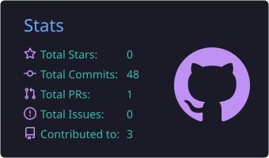
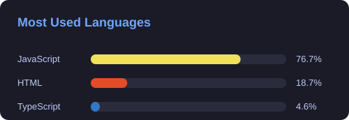
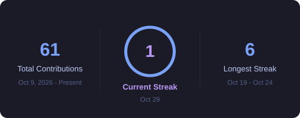
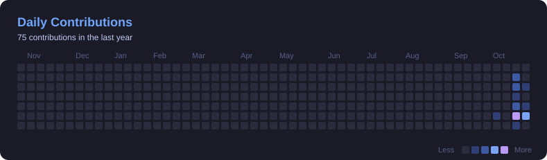

<!-- Banner -->

 

 

<h2 align="left">About me</h2>

✨ Building, breaking, and learning every day  📚 Currently exploring Angular & ASP.NET Core  🎯 Goal: From “It works on my machine” to “It works everywhere”  🎲 Always curious, always improving

<h2 align="left">I code with</h2>

  
  
  
  
  

<h2 align="left">📊 My Coding Stack and Progress</h2>

  <!--  -->
  &nbsp;&nbsp;
  
  &nbsp;&nbsp;
  

  

